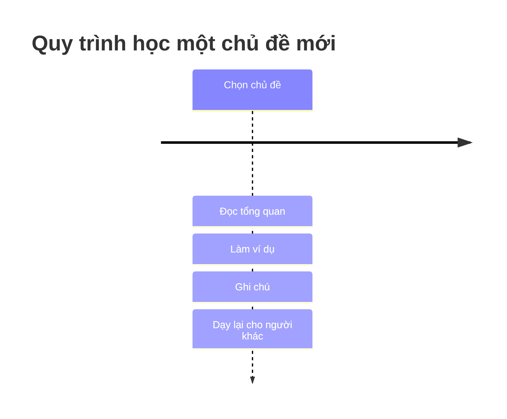

# Phương pháp ghi chú khi tự học

Mẫu bài viết dạng "ghi chú kiến thức" — cấu trúc mình sẽ dùng cho các bài tiếp theo.

<!-- more -->

## Khái niệm

Giải thích ngắn gọn khái niệm học hôm nay, bằng lời của mình.

## Ví dụ

<!-- markdownlint-disable MD040 -->

<!-- markdownlint-enable MD040 -->

## Tài liệu tham khảo

- Link sách/tài liệu/bài gốc học hôm đó

## Việc cần ôn lại

- [ ] Câu hỏi tự kiểm tra 1
- [ ] Câu hỏi tự kiểm tra 2
